# EX19 — Demo-supported large-action sweep

**목적과 비교.** 원본 demo에 실제로 존재하는 큰 action chunk를 각자의 원본 state에서 아래로만 축소하고, 같은 action·seed에서 BG0–BG15의 생성 궤적과 shared-latent flow를 비교했다. 5개 bases × 5 scales × 16 backgrounds × 3 seeds, 최초 20 actions만 사용했다.

**핵심 결과.** 전체 배경에서 α=0→1의 궤적 차이는 평균 0.108→1.321 px로 증가했습니다. 5개 state 모두 증가 경향을 보였고 4개는 단조 증가했습니다. Supported action에서도 배경에 따른 action 실현 차이가 나타납니다. 다만 early flow는 측정 영역을 고정하면 평균이 감소해, 일관된 early-flow 증가까지 확인됐다고 볼 수는 없습니다.

**배경 확장의 차이.** α1에서 기존 BG1–BG3의 평균 trajectory drift는 0.201 px였고, 전체 BG1–BG15는 1.321 px였다. 강한 BG5–BG9는 1.831 px, 색상 통제 BG10–BG15는 1.641 px였다. 기존 약한 배경 부분집합의 수치는 그대로 재현됐다.

**검증.** 1,200개 조건과 동일 BG 반복 10개, 1,125개 paired trajectory, 75개 shared-latent 그룹 검증 완료. Action·noise·초기 물리 상태·scheduler를 고정했고 clipping은 없었습니다. 동일 BG 반복 차이는 0 px입니다. 동일 GT의 배경별 tracker 차이는 0.008–0.078 px, 정지영상 tracking drift는 0.068–0.103 px입니다. 기존 영상 1개의 frame 1개만 제외됐고, 해당 pair 전체를 빼도 조건 평균 변화는 최대 0.015 px였습니다.

## 질문별 답

1. **1. Extrapolation 없이 자연적으로 큰 demo action을 찾았나?** 예. 6개 task의 300개 first chunks 중 크기 P80–P94의 5개 원본 demo를 사용했습니다. 각자의 원본 scene·state와 gripper 명령을 유지했고 α>1은 사용하지 않았습니다. 전체 학습 분포의 IID를 증명한 것은 아닙니다.

2. **2. Supported 조건에서도 action 크기에 따라 trajectory drift가 증가했나?** 예, 이번 5개 state에서는 이를 지지합니다. Global well-supported 조건의 within-state Pearson/Spearman은 0.541/0.757이고, 같은 task의 support만 적용해 비교 가능한 3개 state에서도 0.785/0.786입니다. 다만 supported 조건은 25개 중 15개이며 α=.5는 포함되지 않습니다. Action-only support가 state–action–history의 joint IID를 보장하지는 않습니다.

3. **3. Early denoising flow도 증가했나?** ROI 정의에 따라 달라집니다. 각 α의 GT robot ROI에서는 평균 0.0789→0.1135로 증가하고 4/5 state의 기울기가 양수입니다. Middle은 0.0851→0.0988, late는 0.0934→0.0745였습니다. 그러나 α1의 ROI로 영역을 고정하면 early는 0.1480→0.1135로 감소하고 양의 기울기는 1/5뿐입니다. 따라서 early에서 더 강해진다는 해석은 견고하지 않습니다.

4. **4. 각 initial state 안에서도 경향이 일관적인가?** Trajectory는 5/5 state에서 양의 기울기, 4/5에서 5개 α의 단조 증가를 보였습니다. C01이 평균 증가분의 약 77%를 차지하지만, 이를 제외한 4개 state도 평균 0.100→0.456 px로 증가했습니다. 효과의 크기는 state에 크게 의존하며, early flow의 단조 증가는 1/5 state뿐입니다.

5. **5. NN 거리와 action 크기 중 어느 쪽이 더 잘 설명하나?** Within-state trajectory 상관은 magnitude 0.512, NN 거리 −0.100으로 크기와의 관계가 더 뚜렷합니다. 그러나 다른 state를 예측하는 leave-one-state-out RMSE는 magnitude 0.805, NN 0.799 px로 거의 같습니다. Early flow도 각각 0.0242/0.0235로 비슷합니다. NN 거리 증가만으로 효과를 설명하기 어렵지만, 새로운 state에서 magnitude가 더 우수한 예측자라고 확정할 수도 없습니다.

6. **6. Weak support/OOD 이전에도 효과가 있나?** 예. C01 α1은 원본 demo action 그대로이며 leave-self-out NN은 real-demo P18 근처인데도 평균 trajectory drift가 4.783 px였습니다. Global support가 높은 조건과 같은-task support 부분집합에서도 증가 관계가 남았습니다. 따라서 모든 효과를 action extrapolation OOD로 설명할 수는 없습니다.

7. **7. 이전 α>1 결과는 기존 경향의 증폭인가, 새로운 OOD failure인가?** 아직 구분할 수 없습니다. 이번 결과는 extrapolation 없이도 효과가 존재함을 보입니다. 하지만 EX18은 다른 settled state이고, α1.5/1.75는 NN 기준으로 P99/관측 최댓값 밖입니다. Figure 6은 양쪽 배경을 BG1–BG3로 맞췄지만 state 차이가 남으므로, 이전 결과가 같은 현상의 증폭인지 별도의 OOD failure인지는 단정하지 않습니다.

8. **8. Generated motion 자체도 증가했나?** 예. 5개 state 모두 생성 움직임이 단조 증가했고 전체 평균은 0.254→19.956 px였습니다. GT 평균 EE 움직임도 6.56→64.17 mm로 증가했습니다. 오차만 커진 결과는 아닙니다. α0은 원본 gripper 명령과 state를 유지한 zero-arm 조건이며, 물리적 no-op은 아닙니다.

## α별 요약

값은 5개 base 평균 ± base 간 SD. 각 base는 3 seeds와 15 BG comparisons를 평균했다. GT motion은 초기 EE 위치로부터 평균 3D 거리(mm), generated motion은 초기 손목 centroid로부터 평균 2D 거리(px). Trajectory drift는 BG0와 BGb 손목 trajectory의 평균 거리(px). Flow는 robot-associated latent ROI의 raw velocity RMS 차이.

| α | GT motion mm | Generated motion px | BG trajectory drift px | Early flow | Middle | Late | Well-supported |
|---|---:|---:|---:|---:|---:|---:|---:|
| 0 | 6.560 ± 2.329 | 0.254 ± 0.071 | 0.108 ± 0.035 | 0.079 ± 0.021 | 0.085 ± 0.024 | 0.093 ± 0.013 | 5/5 |
| 0.25 | 19.568 ± 2.296 | 4.816 ± 0.798 | 0.251 ± 0.153 | 0.076 ± 0.023 | 0.078 ± 0.022 | 0.084 ± 0.014 | 2/5 |
| 0.5 | 34.449 ± 3.607 | 9.972 ± 1.703 | 0.423 ± 0.391 | 0.082 ± 0.033 | 0.080 ± 0.025 | 0.079 ± 0.013 | 0/5 |
| 0.75 | 49.346 ± 5.017 | 15.103 ± 2.422 | 0.834 ± 1.127 | 0.095 ± 0.050 | 0.086 ± 0.035 | 0.075 ± 0.012 | 3/5 |
| 1.0 | 64.166 ± 6.444 | 19.956 ± 3.564 | 1.321 ± 1.953 | 0.114 ± 0.069 | 0.099 ± 0.046 | 0.074 ± 0.012 | 5/5 |

## Support와 선정

6개 cached task의 first chunk 300개를 기준으로 했다. 전체 training dataset을 확인한 것은 아니다.

| Percentile | P25 | P50 | P75 | P90 | P95 | Max |
|---|---:|---:|---:|---:|---:|---:|
| Mean arm magnitude | 0.36709 | 0.48347 | 0.57142 | 0.65393 | 0.71166 | 0.83482 |
| RMS arm magnitude | 0.42571 | 0.53325 | 0.61135 | 0.69842 | 0.73986 | 0.85197 |
| Real-demo LOO NN | 0.02233 | 0.02995 | 0.03599 | 0.04110 | 0.04464 | 0.06566 |

모든 α에서 원본 base chunk 자신을 NN 검색에서 제외했다. Official float32 model arm [20,6]을 펼친 120차원 Euclidean distance다. ≤실제 LOO P75: well-supported, P75–P95: borderline, >P95: weakly supported. 이는 상대적 거리의 기술적 분류이며 IID/OOD 경계의 증명이 아니다. 25개 조건 중 15개 well-supported, 8개 borderline, 2개 weakly supported다. α=.5에는 well-supported 조건이 없다.

- **C01**: STUDY_SCENE1_pick_up_the_book_and_place_it_in_the_back_compartment_of_the_caddy, demo_6, first [0:20], M=0.5899, P80.3, dataset index=106.
- **C02**: STUDY_SCENE2_pick_up_the_book_and_place_it_in_the_back_compartment_of_the_caddy, demo_44, first [0:20], M=0.5936, P81.3, dataset index=194.
- **C03**: STUDY_SCENE3_pick_up_the_white_mug_and_place_it_to_the_right_of_the_caddy, demo_34, first [0:20], M=0.6307, P87.0, dataset index=234.
- **C04**: STUDY_SCENE4_pick_up_the_book_on_the_right_and_place_it_on_the_cabinet_shelf, demo_38, first [0:20], M=0.6559, P90.7, dataset index=288.
- **C05**: LIVING_ROOM_SCENE2_put_both_the_cream_cheese_box_and_the_butter_in_the_basket, demo_36, first [0:20], M=0.7033, P94.3, dataset index=36.

## 크기와 NN 거리의 설명력

Base×α 평균을 단위로 계산했다. `within`은 각 base 평균을 제거한 값이다. 조건/seed를 독립 표본으로 취급한 p-value는 제시하지 않는다.

| 조건 | x → y | Pearson pooled | Spearman pooled | Pearson within | Spearman within |
|---|---|---:|---:|---:|---:|
| all (n=25) | M_mean → D_traj_px_mean | 0.355 | 0.512 | 0.512 | 0.794 |
| all (n=25) | M_mean → early_flow_mean | 0.228 | -0.010 | 0.505 | 0.467 |
| all (n=25) | d_NN → D_traj_px_mean | -0.230 | 0.158 | -0.100 | -0.026 |
| all (n=25) | d_NN → early_flow_mean | -0.309 | -0.367 | -0.192 | -0.415 |
| well_supported (n=15) | M_mean → D_traj_px_mean | 0.373 | 0.607 | 0.541 | 0.757 |
| well_supported (n=15) | M_mean → early_flow_mean | 0.276 | -0.022 | 0.518 | 0.539 |
| well_supported (n=15) | d_NN → D_traj_px_mean | -0.139 | 0.484 | -0.015 | 0.311 |
| well_supported (n=15) | d_NN → early_flow_mean | -0.182 | -0.229 | -0.059 | 0.050 |
| well_supported_positive (n=10) | M_mean → D_traj_px_mean | 0.147 | -0.248 | 0.718 | 0.786 |
| well_supported_positive (n=10) | M_mean → early_flow_mean | 0.049 | -0.297 | 0.720 | 0.643 |
| well_supported_positive (n=10) | d_NN → D_traj_px_mean | -0.938 | -0.661 | -0.977 | -0.786 |
| well_supported_positive (n=10) | d_NN → early_flow_mean | -0.940 | -0.709 | -0.986 | -0.905 |
| task_restricted_P75 (n=8) | M_mean → D_traj_px_mean | 0.288 | 0.381 | 0.785 | 0.786 |
| task_restricted_P75 (n=8) | M_mean → early_flow_mean | 0.223 | 0.262 | -0.276 | -0.143 |
| task_restricted_P75 (n=8) | d_NN → D_traj_px_mean | -0.439 | 0.119 | 0.094 | -0.036 |
| task_restricted_P75 (n=8) | d_NN → early_flow_mean | -0.496 | -0.238 | -0.855 | -0.786 |

아래는 base 평균을 제거한 후 다른 4개 base에서 관계를 학습하고 남은 base의 변화 형태를 평가한 RMSE다. 낮을수록 좋다. 5개 base뿐인 탐색적 비교이며 새로운 state의 절대값 예측 성능이나 인과관계가 아니다.

| 조건 | Outcome | Magnitude only | NN only | Both |
|---|---|---:|---:|---:|
| all | D_traj_px_mean | 0.80485 | 0.79909 | 0.82332 |
| all | early_flow_mean | 0.02423 | 0.02347 | 0.02342 |
| well_supported | D_traj_px_mean | 1.01943 | 1.00446 | 1.03457 |
| well_supported | early_flow_mean | 0.03095 | 0.03022 | 0.02964 |

## Flow와 최종 trajectory의 관계

Base×α 평균 25개에서 early flow와 trajectory drift의 Pearson/Spearman은 0.925/0.702, within-state 중심화 후 0.978/0.762였다. C01을 제외해도 within-state 상관은 0.704/0.534로 남았다. 1,125개 BG×seed×α pair의 pooled 상관은 0.797/0.651이다. 그러나 이 값은 scale별 GT robot ROI를 쓴 결과다. 고정 ROI에서는 action 크기에 따른 early flow 증가가 유지되지 않으므로, 상관만으로 early flow가 원인이거나 일반적인 예측자라고 결론 내리지 않는다. Background 종류와 ROI 구성의 영향도 남아 있다.

## Base × α 전체 요약

Trajectory와 flow는 seed SD를 함께 표기했다. 전체 raw metrics와 final/max/ADE/FDE는 CSV에 있다.

| Base/task | α | M | NN distance / support | GT mm | Generated px | BG trajectory px | Early | Middle | Late |
|---|---:|---:|---|---:|---:|---:|---:|---:|---:|
| C01/Original | 0.0 | 0.0000 | 0.01749 / well-supported | 6.689 | 0.365 | 0.1425 ± 0.0922 | 0.0991 ± 0.0005 | 0.1075 ± 0.0018 | 0.0978 ± 0.0050 |
| C01/Original | 0.25 | 0.1475 | 0.03307 / well-supported | 21.481 | 4.754 | 0.4903 ± 0.1185 | 0.1031 ± 0.0029 | 0.0981 ± 0.0060 | 0.0852 ± 0.0040 |
| C01/Original | 0.5 | 0.2949 | 0.04304 / borderline | 37.553 | 9.600 | 1.0937 ± 0.1999 | 0.1308 ± 0.0058 | 0.1096 ± 0.0135 | 0.0830 ± 0.0012 |
| C01/Original | 0.75 | 0.4424 | 0.02483 / well-supported | 53.566 | 13.876 | 2.8186 ± 0.8334 | 0.1786 ± 0.0107 | 0.1408 ± 0.0209 | 0.0794 ± 0.0022 |
| C01/Original | 1.0 | 0.5899 | 0.02033 / well-supported | 69.452 | 16.999 | 4.7826 ± 1.5399 | 0.2325 ± 0.0069 | 0.1783 ± 0.0196 | 0.0849 ± 0.0012 |
| C02/T01 | 0.0 | 0.0000 | 0.01749 / well-supported | 7.251 | 0.212 | 0.1137 ± 0.0352 | 0.0831 ± 0.0000 | 0.0896 ± 0.0006 | 0.0958 ± 0.0017 |
| C02/T01 | 0.25 | 0.1484 | 0.03432 / well-supported | 21.846 | 6.068 | 0.2237 ± 0.0747 | 0.0793 ± 0.0007 | 0.0833 ± 0.0012 | 0.0825 ± 0.0021 |
| C02/T01 | 0.5 | 0.2968 | 0.04451 / borderline | 38.283 | 11.988 | 0.2911 ± 0.1348 | 0.0789 ± 0.0002 | 0.0802 ± 0.0020 | 0.0806 ± 0.0009 |
| C02/T01 | 0.75 | 0.4452 | 0.03480 / well-supported | 54.756 | 18.280 | 0.3380 ± 0.0810 | 0.0780 ± 0.0008 | 0.0724 ± 0.0035 | 0.0758 ± 0.0004 |
| C02/T01 | 1.0 | 0.5936 | 0.03267 / well-supported | 71.159 | 23.841 | 0.4608 ± 0.0835 | 0.0875 ± 0.0016 | 0.0805 ± 0.0089 | 0.0766 ± 0.0007 |
| C03/T02 | 0.0 | 0.0000 | 0.01749 / well-supported | 4.356 | 0.278 | 0.1322 ± 0.0609 | 0.0817 ± 0.0002 | 0.0883 ± 0.0010 | 0.0948 ± 0.0026 |
| C03/T02 | 0.25 | 0.1577 | 0.04306 / borderline | 16.285 | 3.998 | 0.2856 ± 0.1310 | 0.0788 ± 0.0018 | 0.0811 ± 0.0015 | 0.0860 ± 0.0020 |
| C03/T02 | 0.5 | 0.3154 | 0.04551 / weakly supported | 29.359 | 7.720 | 0.4152 ± 0.1568 | 0.0863 ± 0.0032 | 0.0863 ± 0.0085 | 0.0820 ± 0.0020 |
| C03/T02 | 0.75 | 0.4731 | 0.03819 / borderline | 42.440 | 11.976 | 0.6653 ± 0.0966 | 0.0977 ± 0.0043 | 0.0909 ± 0.0084 | 0.0801 ± 0.0022 |
| C03/T02 | 1.0 | 0.6307 | 0.02976 / well-supported | 55.476 | 15.979 | 0.8877 ± 0.2599 | 0.1091 ± 0.0054 | 0.0955 ± 0.0076 | 0.0774 ± 0.0017 |
| C04/T03 | 0.0 | 0.0000 | 0.01749 / well-supported | 4.478 | 0.183 | 0.1003 ± 0.0263 | 0.0872 ± 0.0002 | 0.0950 ± 0.0006 | 0.1062 ± 0.0048 |
| C04/T03 | 0.25 | 0.1640 | 0.04025 / borderline | 18.393 | 4.283 | 0.1702 ± 0.0635 | 0.0784 ± 0.0012 | 0.0869 ± 0.0030 | 0.1020 ± 0.0027 |
| C04/T03 | 0.5 | 0.3279 | 0.04347 / borderline | 33.725 | 9.241 | 0.2067 ± 0.1291 | 0.0753 ± 0.0018 | 0.0824 ± 0.0037 | 0.0909 ± 0.0066 |
| C04/T03 | 0.75 | 0.4919 | 0.03001 / well-supported | 49.033 | 14.859 | 0.1887 ± 0.0157 | 0.0759 ± 0.0017 | 0.0804 ± 0.0029 | 0.0844 ± 0.0047 |
| C04/T03 | 1.0 | 0.6559 | 0.03128 / well-supported | 64.279 | 19.678 | 0.3007 ± 0.0607 | 0.0790 ± 0.0022 | 0.0820 ± 0.0029 | 0.0797 ± 0.0024 |
| C05/T04 | 0.0 | 0.0000 | 0.01749 / well-supported | 10.026 | 0.234 | 0.0538 ± 0.0215 | 0.0433 ± 0.0001 | 0.0453 ± 0.0021 | 0.0721 ± 0.0021 |
| C05/T04 | 0.25 | 0.1758 | 0.03726 / borderline | 19.838 | 4.974 | 0.0837 ± 0.0228 | 0.0392 ± 0.0001 | 0.0412 ± 0.0013 | 0.0627 ± 0.0021 |
| C05/T04 | 0.5 | 0.3517 | 0.04700 / weakly supported | 33.327 | 11.312 | 0.1089 ± 0.0327 | 0.0388 ± 0.0005 | 0.0395 ± 0.0013 | 0.0569 ± 0.0016 |
| C05/T04 | 0.75 | 0.5275 | 0.04060 / borderline | 46.934 | 16.527 | 0.1618 ± 0.0182 | 0.0449 ± 0.0003 | 0.0462 ± 0.0019 | 0.0551 ± 0.0023 |
| C05/T04 | 1.0 | 0.7033 | 0.03480 / well-supported | 60.465 | 23.285 | 0.1752 ± 0.0626 | 0.0596 ± 0.0007 | 0.0578 ± 0.0048 | 0.0536 ± 0.0021 |

## 해석의 한계

- Support는 action sequence의 주변 거리다. 원래 state·scaled action의 joint support, synthetic repeated-frame history의 training support까지 보장하지 않는다. 원본 α1과 축소 α의 의미도 구분해야 한다.
- α0은 arm command만 0이다. 원본 state를 유지하여 GT 최대 arm 변위 5.16–12.00 mm가 남았다. 그리퍼를 유지한다는 것은 원본 **명령** 유지이며 실제 gripper position이 정지한다는 뜻이 아니다. 이 결과를 물리적 no-op/spontaneous-motion 실험으로 해석하지 않는다.
- C05의 원본 객체에는 settling이 있었다. 모든 BG/α에서 같았고 해당 base를 제외한 분석도 저장했다.
- 작은 subpixel 차이에는 tracking 및 생성된 손 모양 변화의 기여가 남는다. 정지영상 평균 drift는 0.068–0.103 px(최대 0.119 px), GT oracle tracking ADE는 0.047–0.418 px, 물리적으로 동일한 GT의 paired BG tracker 차이는 0.008–0.078 px다. 서로 다른 오차 기준이며 단일 임계값으로 합치지 않는다. 유효 frame만 사용했고 point membership 변경이나 interpolation은 없다. 생성된 손의 변형은 GT 대조군보다 큰 추적 오차를 만들 수 있다.
- 5개 state와 3개 seeds뿐이다. 같은 task의 여러 state를 포함하지 않아 task 효과와 state 효과를 분리할 수 없다.
- Early step은 α 간에도 같은 x다. Middle/late은 α마다 다른 BG0 path를 사용하므로 early와 같은 직접적인 α 비교로 간주하지 않는다. Fixed α1 ROI 결과도 함께 확인한다.
- EX18은 다른 settled state에서 α>1로 extrapolate한 결과다. 두 실험의 차이만으로 OOD가 원인이라고 단정할 수 없다.
- 원본 float64와 실제 float32 raw action을 모두 저장했다. 최대 raw rounding 4.77e-8, BF16 변환도 기록했다. Clipping은 없고 gripper 원본 -1을 유지했다.

## 전체 배경 확장

EX8의 BG0–BG15 정의를 그대로 사용했다. 기존 BG0–BG3 수치·code·입력 snapshot은 `baseline_BG0_BG3/`에 보존했다. 추가한 12개 배경에서도 원본 물리 상태, action, camera, lighting, 생성 noise, scheduler를 유지했다. 기존 BG0의 denoising x를 그대로 불러와 local flow를 측정했다. 이전 EX18과 비교하는 Figure 6은 양쪽 모두 BG1–BG3로 맞췄다. 배경 그룹별 결과와 모든 BG의 heatmap은 Figure 10–11에 있다.

## 산출물

- [상세 방법](METHODS.md), [최종 audit](final_audit.json), [통계](statistics.json)
- [Base별 요약](summary_by_base.csv), [α별 요약](summary_by_alpha.csv), [Seed별 결과](per_seed_summary.csv), [Pair별 결과](paired_metrics.csv)
- [Generated metrics](generated_metrics.csv), [Flow metrics](flow_metrics.csv), [Tracking controls](tracking_controls.csv), [Repeat controls](repeat_controls.csv)
- 원본 state/XML/controller snapshot/정확한 actions/GT: `cases/Cxx/data/`
- Generated frames, videos, BF16 actions, shared x, flow fields: `cases/Cxx/results/seed*/a*/`
- [NN support](support_conditions.json), [이전 EX18의 동일 기준 NN](previous_extrapolation_support.json)
- [사이트](../index.html), 대표 overlay videos: `results/overlay_videos/`

### Demo magnitude distribution

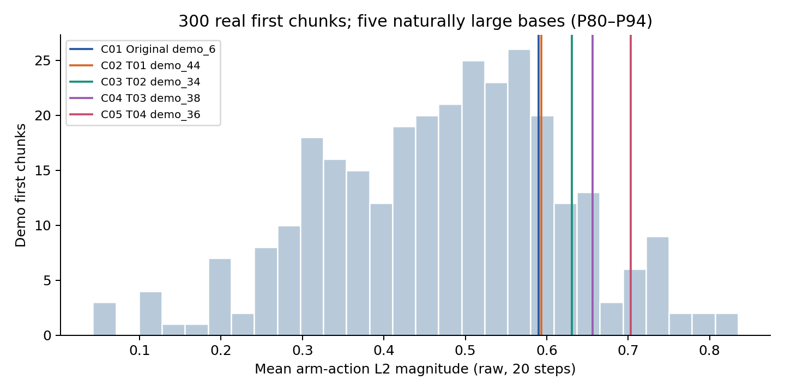

### Magnitude versus trajectory drift

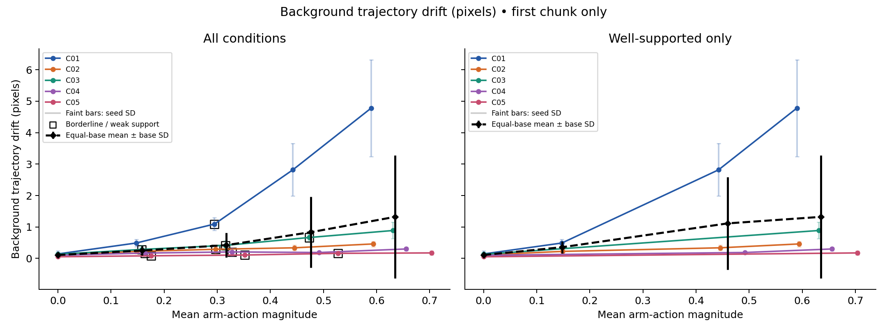

### Magnitude versus early flow

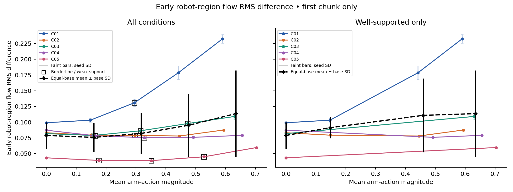

### Early/middle/late

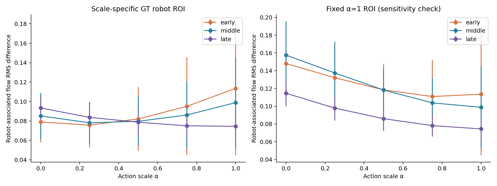

### NN versus trajectory

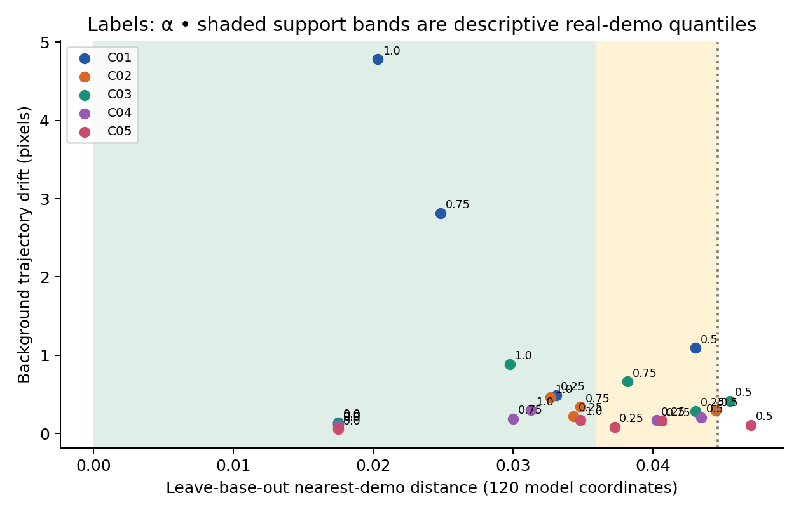

### NN versus early flow

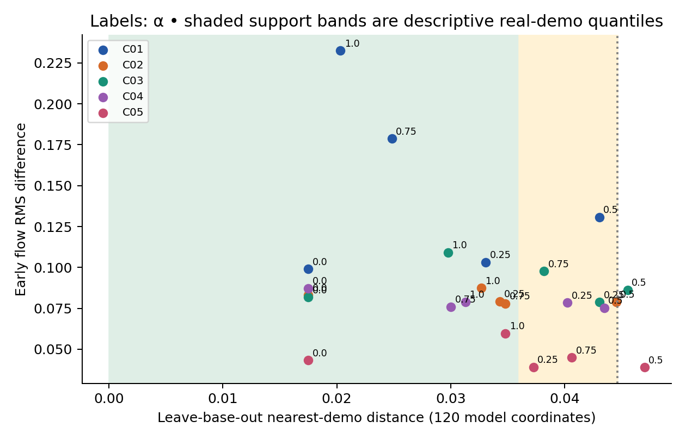

### Previous extrapolation separately

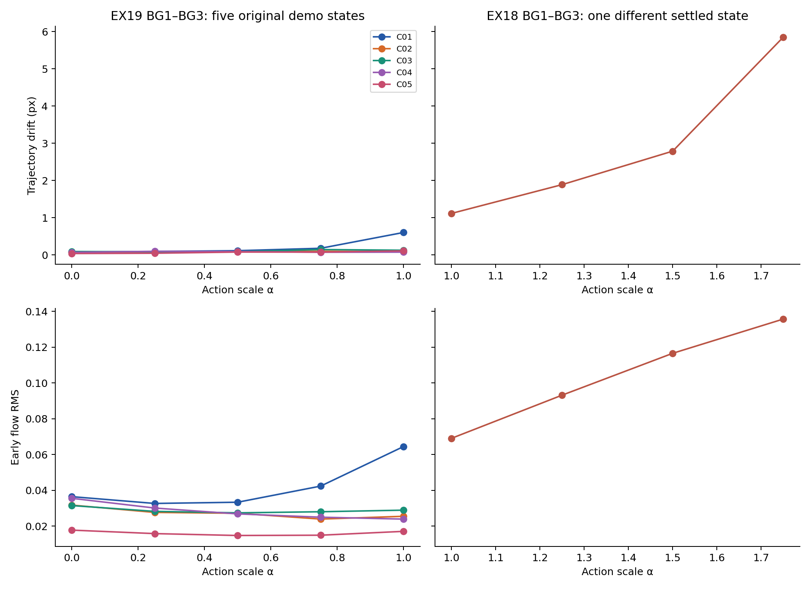

### Flow versus trajectory

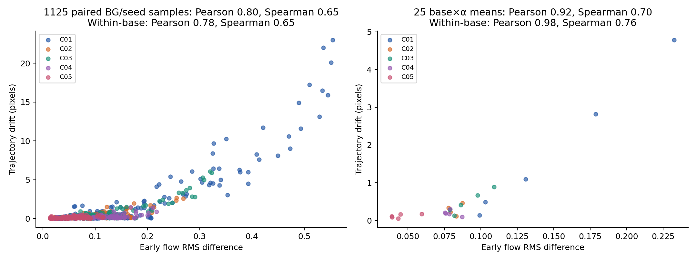

### Generated motion and GT error

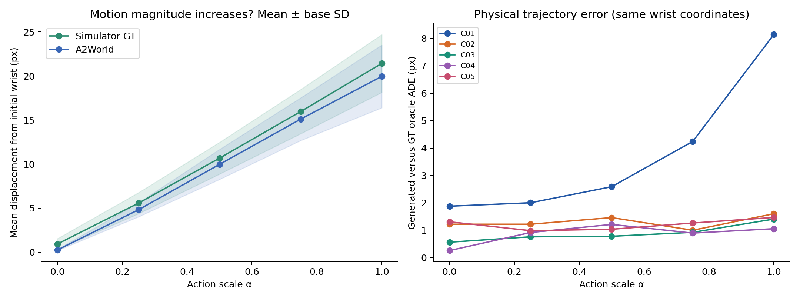

### Original and full background families

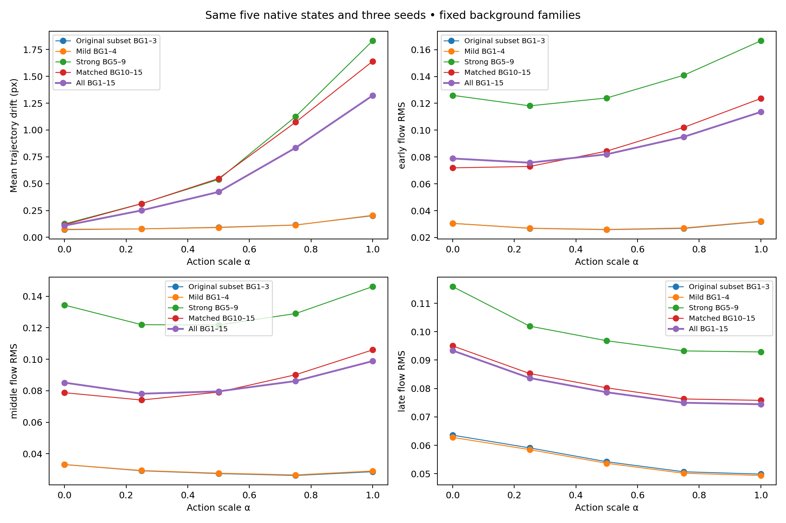

### Each background separately

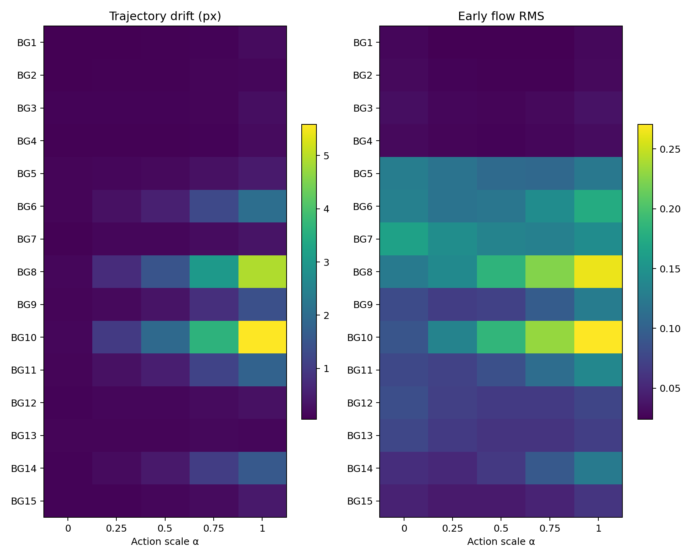

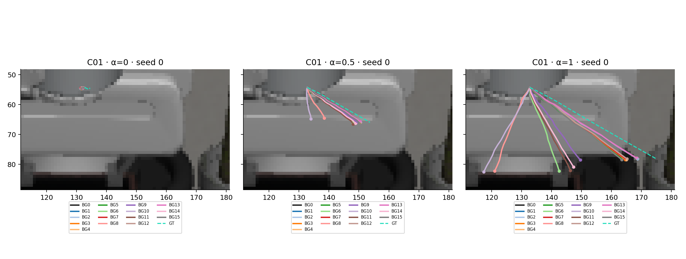

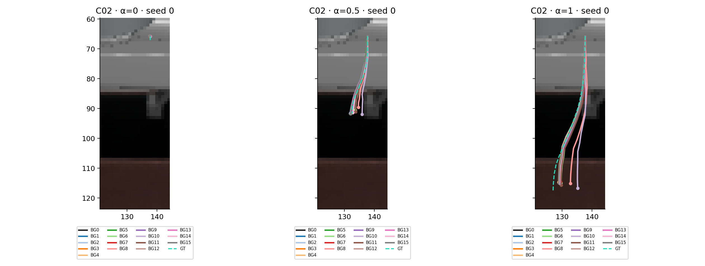

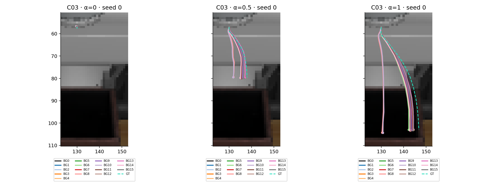

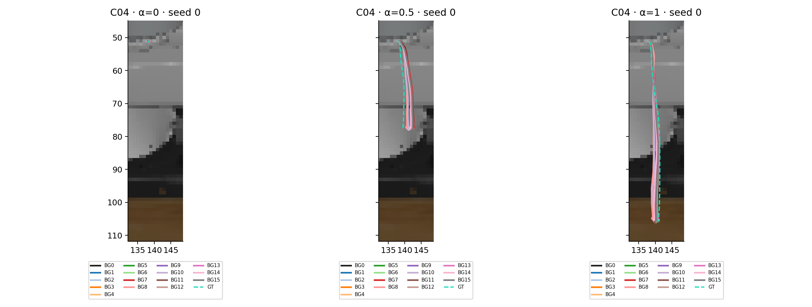

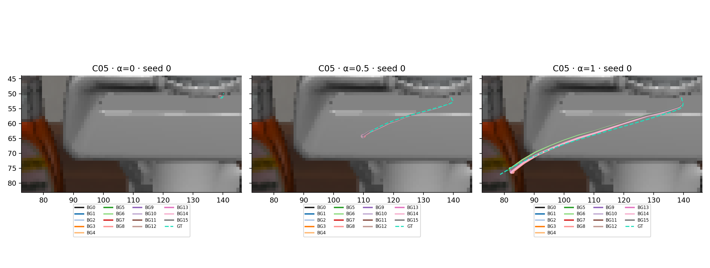
